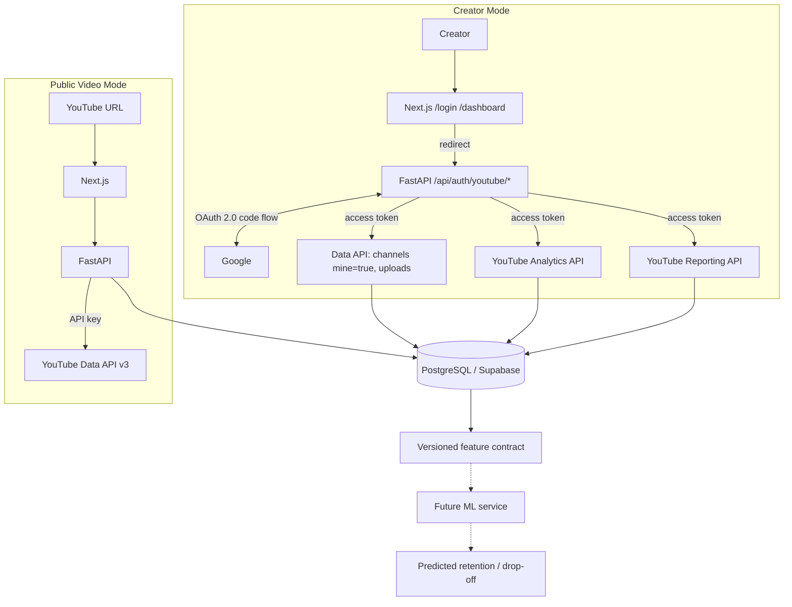

# RetainAI — Retention Predictor

**Find the drop-off before you publish.** A lightweight, retention-focused alternative to YouTube Studio:
paste any public video link, or connect your channel to see analytics and real audience-retention curves.

## 1. Current scope

| Mode | What works today |
| --- | --- |
| **Public Video Mode** (no login) | Paste a YouTube URL → video + channel metadata, public stats, category name, normalized report, DB cache, ML-ready feature payload |
| **Creator Mode** (Google OAuth) | Sign in with YouTube → channel identification, uploads sync (incl. private/unlisted), channel analytics, video table, per-video analytics, **audience retention curve** (`audienceWatchRatio`, `relativeRetentionPerformance`), observed drop-offs, traffic sources, geography, devices, Reporting API jobs, background sync |

| **Intelligence layers** | **Channel Intelligence** ("what works for this creator?"), **Video Intelligence** ("what is weak in this video?"), **Trend Radar** ("what is happening in this genre?"), a transcript engine (uploaded TXT/SRT/VTT or Groq Whisper), deterministic content features, Groq-written explanations, channel-vs-genre benchmarking |

**ML engine (new):** a retention-prediction model trained on **synthetic** gaming data (`synthetic_v1`, 420 videos) predicts a per-segment retention curve, risk regions and model-based explanations; Groq only *explains* the model's output. **It has not been validated on real YouTube retention** and every prediction is labelled `DEVELOPMENT / SYNTHETIC DATA`. See the ML section below and [docs/ml-integration.md](docs/ml-integration.md).

## 1a. Product concept

```text
PAST     Channel Intelligence  – what has worked on your channel?
PRESENT  Video Intelligence    – what is weak in this video, and what could you test?
FUTURE   Trend Intelligence    – what is visible in recent public content for a genre?
         + (later) ML retention prediction
```

Reports always separate **observation** (a number from the data) → **interpretation** (hedged) → **recommendation** (an experiment to test). Language is associative ("videos in this cluster were associated with…"), never causal, and no outcome is promised.

### Channel Intelligence — `/dashboard` → “Channel Report”
Aggregates your analytics and content features: videos analyzed, views, watch time, view %, subs, upload frequency, topic clusters (TF-IDF over titles/descriptions), formats, **data-derived** title patterns, duration buckets, intro length (when transcripts exist), recurring transcript themes, and observed associations (only for groups of ≥3 videos). A compact evidence package then goes to Groq for the written report (strengths, weaknesses, patterns, experiments).

### Video Intelligence — `/video/[video_id]`
Metadata + analytics + **observed** retention (`audienceWatchRatio`, raw points stored in `video_retention_points`) + transcript features. Sections: hook analysis (hook latency, first payoff, topic reveal), **promise gap** (a content-structure feature, not claimed as a cause of drop-off), pacing (words/min, sentence density, topic transitions; silence is *Data unavailable* without audio), repetition (TF-IDF similarity, flagged ≥0.55), CTA timestamps (subscribe/like/comment/share/link/product; English + Hinglish cues), observed drop-offs **linked to the transcript text**, Groq review, experiments, and an empty "Predicted retention" panel. **Transcript ↔ retention:** a shared `currentTimestamp` — clicking a transcript line highlights that moment on the chart; clicking the chart scrolls the transcript.

### Trend Radar — `/trends`, Genre benchmark — `/benchmark`
Genre/subgenre/language/region/time-range selectors → official `search.list` (cached, TTL 12 h) → batched `videos.list` → TF-IDF topic clustering → per-topic stats and the **RetainAI Content Momentum Index (v1)**:

```text
momentum = normalized_velocity × recency_factor × engagement_factor
normalized_velocity = median(views/day of the topic's videos) / max over topics
recency_factor      = 0.5 + 0.5 × share of the topic's videos published in the newest third of the window
engagement_factor   = 0.5 + 0.5 × median((likes+comments)/views) / max over topics
HIGH ≥ 0.6, MEDIUM ≥ 0.3, else LOW   (relative to the other topics in the same sample)
```

It is a transparent, versioned, sample-relative measure — **not** a YouTube trend score and **not** the recommendation algorithm. "Recent growth" compares views/day of the newest third of uploads with older ones in the sample (null if too few). The benchmark compares your video length, recent-upload median views, intro length, formats and title patterns with the genre sample, with plain statements and experiment suggestions — no winner score. Values public data can't provide (genre average view %, genre intro length) are shown as **Data unavailable**. Samples under 10 videos are flagged. A pluggable `ExternalTrendProvider` (e.g. Google Trends) exists but is not required or configured.

## 1b. Transcript pipeline & Groq

```text
Provider order (explicit, official/authorized routes only)
 1. YouTubeCaptionProvider   – authorized caption download. captions.download needs the youtube.force-ssl scope
                               (edit permission) which this app does NOT request; disabled unless ENABLE_CAPTION_DOWNLOAD=true.
 2. UploadedTranscriptProvider – POST /api/video/{id}/transcript/upload  (TXT / SRT / VTT)
 3. GroqWhisperProvider      – POST /api/video/{id}/transcript/transcribe (user-supplied audio → Groq Whisper, verbose_json segments)
 none available → "Transcript unavailable for this video." + [Upload Transcript] [Upload Audio]; the report still renders.
```

* TXT with leading `mm:ss` timestamps is read exactly; plain TXT gets **estimated** timestamps (flagged in the UI).
* Whisper language is auto-detected unless you pass `language` (English, Hindi, Hinglish, multilingual). Audio must be < ~24 MB (Groq limit); the server does **not** extract audio from video — upload an audio file (mp3/wav/m4a/webm/mp4 are accepted by Groq).
* Stored in `video_transcripts` + `transcript_segments` (`segment_index, start_seconds, end_seconds, text, language`).
* **Groq** (`GROQ_API_KEY`; models via `GROQ_TRANSCRIPTION_MODEL` default `whisper-large-v3-turbo`, `GROQ_CHAT_MODEL` default `llama-3.3-70b-versatile`): speech-to-text, per-section topic labels, and the channel/video/trend written reports. Prompts live in `backend/app/prompts/` and instruct the model to use **only the supplied evidence** and never invent numbers. Output is requested as JSON and validated with Pydantic; invalid output is retried once with a correction prompt, then a controlled error is returned (raw output is never shown). If Groq is missing/rate-limited/down, the deterministic report is still returned with an explicit "AI unavailable" state. The model's `confidence` on a recommendation is its own judgement, not a statistic.

## 1c. Why scraping is NOT used

Everything comes from official APIs, OAuth-authorized creator data, and user-provided files. There is no HTML scraping, no reverse-engineered endpoints, no browser automation, no unofficial caption/audio downloader. Consequently transcripts for arbitrary public videos are **not** available — the user must upload a transcript or audio.

## 2. Architecture



Which API does what:

| Application feature | API |
| --- | --- |
| Public video metadata | YouTube Data API v3 (API key) |
| Authenticated user's channel | YouTube Data API v3 + OAuth |
| Uploaded videos | YouTube Data API v3 + OAuth |
| Channel overview metrics | YouTube Analytics API |
| Video performance metrics | YouTube Analytics API |
| Audience retention | YouTube Analytics API |
| Traffic sources / geography / devices | YouTube Analytics API |
| Bulk historical channel reports | YouTube Reporting API |
| Future ML input | Internal feature contract |

Layout:

```text
backend/    FastAPI (routes → services → repositories → models), tests
frontend/   Next.js 16 · TypeScript · Tailwind · TanStack Query · Recharts
future-ml/  contracts for the ML team (JSON Schemas)
docs/       ml-integration.md
```

Backend structure: `routes/` (thin) · `services/` (oauth, youtube data/analytics/reporting/sync, ml stub) · `repositories/` (DB access) · `schemas/` (Pydantic) · `models/` (SQLAlchemy) · `utils/`.

## 3. Tech stack

Next.js · TypeScript · Tailwind · TanStack Query · Recharts · FastAPI · Pydantic v2 · httpx · SQLAlchemy 2 (async) · PostgreSQL (Supabase) · `cryptography` (token encryption).

## 4. Environment variables

Copy `.env.example`. The **backend reads `backend/.env`**; the frontend reads `frontend/.env.local`.

| Variable | Where | Secret? | Purpose |
| --- | --- | --- | --- |
| `YOUTUBE_API_KEY` | backend | **yes** | Public Data API calls |
| `GOOGLE_CLIENT_ID` | backend | no (but keep server-side) | OAuth web client |
| `GOOGLE_CLIENT_SECRET` | backend | **yes** | OAuth code exchange / refresh |
| `GOOGLE_REDIRECT_URI` | backend | no | Must exactly match Google Cloud. Default `http://localhost:8000/api/auth/youtube/callback` |
| `GROQ_API_KEY` | backend | **yes** | Groq speech-to-text and report generation. Without it, AI sections show "unavailable" |
| `GROQ_TRANSCRIPTION_MODEL` | backend | no | Default `whisper-large-v3-turbo` |
| `GROQ_CHAT_MODEL` | backend | no | Blank = built-in default `llama-3.3-70b-versatile` |
| `DATABASE_URL` | backend | **yes** | Postgres connection string (`postgresql://…`). Empty/invalid → local SQLite fallback (dev only) |
| `FRONTEND_URL` | backend | no | CORS origin + post-login redirect. Default `http://localhost:3000` |
| `BACKEND_URL` | backend | no | Informational |
| `SESSION_SECRET` | backend | **yes** | Encrypts stored OAuth tokens (Fernet key derived from it). Changing it logs everyone out |
| `NEXT_PUBLIC_API_BASE_URL` | **frontend** | no | Backend URL. The **only** variable exposed to the browser |

Never use `NEXT_PUBLIC_` for any secret. Optional tuning: `CACHE_TTL_HOURS` (public analyses, 6), `ANALYTICS_CACHE_MINUTES` (60), `MAX_SYNC_VIDEOS` (1000), `SESSION_TTL_DAYS` (14).

## 5. Google Cloud setup

1. Select (or create) a Google Cloud project.
2. **Enable APIs** (APIs & Services → Library): *YouTube Data API v3*, *YouTube Analytics API*, *YouTube Reporting API*.
3. **API key** (public mode): Credentials → Create credentials → API key. Under *API restrictions*, allow **YouTube Data API v3** (an API restriction that omits it gives `API_KEY_SERVICE_BLOCKED`). Leave *Application restrictions* = None locally; for a deployed server use IP addresses.
4. **OAuth consent screen**: External, add scopes below, and while the app is in *Testing* add your Google account under **Test users**. (Testing mode refresh tokens expire after 7 days; publish the app for long-lived access. Sensitive scopes need Google verification before public launch.)
5. **OAuth client**: Credentials → Create credentials → OAuth client ID → **Web application**.
6. **Authorized redirect URI** (exact match, including scheme, host, port, path):
   * Local: `http://localhost:8000/api/auth/youtube/callback`
   * Production: `https://YOUR_BACKEND_DOMAIN/api/auth/youtube/callback` (set `GOOGLE_REDIRECT_URI` accordingly; nothing is hardcoded)
7. Put `GOOGLE_CLIENT_ID`, `GOOGLE_CLIENT_SECRET`, `YOUTUBE_API_KEY`, `DATABASE_URL`, `SESSION_SECRET` in `backend/.env`.
   Generate the secret: `python -c "import secrets;print(secrets.token_urlsafe(48))"`.
8. For Supabase use the **Session pooler** connection string (the direct host is IPv6-only). Tables are created automatically on startup.

## 6. OAuth scopes

Exactly two, both read-only:

| Scope | Why |
| --- | --- |
| `https://www.googleapis.com/auth/youtube.readonly` | `channels.list?mine=true`, uploads playlist, video metadata incl. private/unlisted |
| `https://www.googleapis.com/auth/yt-analytics.readonly` | YouTube Analytics + Reporting API reads |

Not requested: any write scope, `yt-analytics-monetary.readonly`, or Google profile/email scopes. Consequence: the app identifies a user by their **YouTube channel** (name/avatar from the channel; `email` is empty). The sign-in requires both permissions; if one is unticked at consent the login is rejected with a clear message.

## 7. Running locally

Backend:

```bash
cd backend
python -m venv .venv
# Windows:       .venv\Scripts\activate
# Linux/macOS:   source .venv/bin/activate
pip install -r requirements.txt
uvicorn app.main:app --reload --port 8000
```

Swagger UI: http://localhost:8000/docs

Frontend:

```bash
cd frontend
npm install
npm run dev        # http://localhost:3000
```

Tests (no real network; Google is mocked):

```bash
cd backend
pip install -r requirements-dev.txt
pytest
```

## 8. API reference

Errors are always `{"error": {"code": "...", "message": "..."}}` (no Google stack traces, no secrets).
Creator routes need the session cookie (`401 NOT_AUTHENTICATED` otherwise). Date params are `start_date` / `end_date` (`YYYY-MM-DD`, default last 28 days); `refresh=true` bypasses the cache.

### Public mode

| Method & route | Description |
| --- | --- |
| `GET /health` | `{"status":"ok","database":"postgres\|sqlite-fallback"}` |
| `GET /api/youtube/video/{video_id}` | Normalized public video (title, channel, duration, category name, stats, thumbnail) |
| `POST /api/analyze` `{"youtube_url"}` | Validate → fetch video+channel → cache in DB → report with `features`, `feature_readiness`, `ml_status`. `?refresh=true` skips the cache. Returns `cached` flag |
| `GET /api/analyses` · `GET /api/analyses/{id}` | Recent analyses · one stored report (`?include_raw=true`) |
| `GET /api/youtube/channel/{channel_id}` | Public channel (accepts `UC…` id or `@handle`) |
| `GET /api/youtube/channel/{channel_id}/videos?limit=&pageToken=` | Paginated recent uploads (`items`, `next_page_token`) |

### Auth

| Method & route | Description |
| --- | --- |
| `GET /api/auth/youtube/login` | 302 to Google (state in a short-lived HttpOnly cookie) |
| `GET /api/auth/youtube/callback` | Validates `state`, exchanges the code, identifies the channel, stores encrypted tokens, sets the session cookie, 302 to `/dashboard`. Failures 302 to `/login?error=<CODE>` |
| `GET /api/auth/me` | `{authenticated, user:{name,email,image}, channel:{id,title}}` — never tokens |
| `POST /api/auth/logout` | Deletes the server-side session (does **not** revoke the Google grant) |

### Creator channel & sync

| Method & route | Description |
| --- | --- |
| `GET /api/channel/me` | Stored channel (subscribers, views, video count, uploads playlist id, `last_synced_at`) |
| `GET /api/channel/me/videos?page&limit&search&sort` | Synced library from the DB (`sort`: newest, oldest, views, longest, shortest) |
| `POST /api/sync` | Starts a background sync → `{"sync_id","status":"started"}` (returns the running job if one exists) |
| `GET /api/sync/{sync_id}` | `{status: started\|running\|completed\|failed, step, stats, error_*}` |

### Analytics (YouTube Analytics API, cached 60 min in PostgreSQL)

| Route | Description |
| --- | --- |
| `GET /api/analytics/overview` | views, engaged views (when supported), watch time (min), avg view duration (s), avg view % (percent), likes, comments, shares, subs gained/lost, **net subs** (= gained − lost) |
| `GET /api/analytics/timeseries` | Per-day views, watch time, subs gained/lost/net |
| `GET /api/analytics/videos?page&limit&sort&search` | Library merged with **one batched** Analytics report (top 200 videos by views in range). `sort`: newest, oldest, views, highest_avp, lowest_avp, longest, shortest. Includes descriptive `insights` (avg/median view %, duration, views per video, videos analyzed) |
| `GET /api/analytics/video/{video_id}` | One video's metrics |
| `GET /api/analytics/video/{video_id}/retention` | `elapsedVideoTimeRatio` curve: raw `points[]` (`time_ratio`, `audience_watch_ratio`, `relative_retention_performance`, optional `started_watching`/`stopped_watching`) and `observed_drop_offs` (largest actual declines — not predictions). **One video per request** (an Analytics API requirement) and only requested when a video is selected |
| `GET /api/analytics/video/{video_id}/ml-features` | Versioned ML contract (see docs) |
| `GET /api/analytics/traffic-sources` · `/geography` · `/devices` | Breakdown rows (views, watch time, avg duration, avg view % where YouTube supports them); optional `video_id` |

### Reporting API

| Method & route | Description |
| --- | --- |
| `GET /api/reporting/report-types` | `reportTypes.list` |
| `GET /api/reporting/jobs` | Jobs stored for the user |
| `POST /api/reporting/jobs` `{"report_type"?}` | Idempotent job creation (default `channel_basic_a3`) |
| `GET /api/reporting/jobs/{id}` · `/jobs/{id}/reports` | `jobs.get` · `jobs.reports.list` (records generated reports; no downloads) |
| `POST /api/reporting/reports/{id}/process` | Downloads one report on demand, records row count/columns (contents aren't stored) |

### Intelligence (creator login required unless noted)

| Method & route | Description |
| --- | --- |
| `GET /api/channel/report?start_date&end_date&refresh` | Channel Intelligence: deterministic overview/patterns/associations + Groq report (`groq.available`). Cached in `channel_reports` |
| `GET /api/content-patterns` | Topic clusters, formats, title patterns, keywords, performance associations |
| `GET /api/channel/benchmark?genre&subgenre&language&region&time_window` | Channel vs genre sample (rows with channel/genre/difference/statement/experiment; `status: ok\|insufficient_sample`) |
| `GET /api/video/{id}/report?refresh` | Video Intelligence report (retention + transcript features + drop-offs linked to transcript + Groq review). Cached in `video_reports`; invalidated when the transcript changes |
| `GET /api/video/{id}/transcript` | Stored transcript, or `{available:false, message:"Transcript unavailable for this video.", options:[...]}` |
| `POST /api/video/{id}/transcript/upload` | JSON `{format: txt\|srt\|vtt, content, language?}` |
| `POST /api/video/{id}/transcript/transcribe` | multipart `file` (+ `language?`) → Groq Whisper |
| `GET /api/video/{id}/ml-input` | The future model's `MLInput` filled with real data only |
| `GET /api/genres` | Genres, subgenres, languages, regions, time windows |
| `GET /api/genres/{genre}/trends` · `GET /api/trends?genre=` | Trend Radar (public, API key). Params: `subgenre, language, region, time_window (7d\|30d\|90d), refresh, include_ai` |
| `GET /api/trends/{topic}?genre=` | One topic's detail from the cached sample |
| `GET /api/system/api-usage` | Application-side call counters (not Google's exact quota) |

### ML

| Route | Description |
| --- | --- |
| `GET /api/ml/status` | `model_available`, `model_name`, `model_version`, `feature_schema_version`, `trained_on` (`synthetic`), `real_validation_available` (`false`) |
| `POST /api/ml/predict` | `{video_id, video, transcript, features}` → `PredictionResult` (curve points, risk segments with model-based explanations, uncertainty). `501` if no artifact, `503` while loading |
| `POST /api/ml/predict-text` | Paste/upload ANY transcript (`{title, format: txt\|srt\|vtt, content}`) → parsed → same inference pipeline → prediction |
| `GET /api/ml/models` · `GET /api/ml/metrics` | Model registry (candidate / production / rejected / archived) with training runs · prediction count, real labelled videos, recent real error, drift warning (only with enough real samples) |
| `POST /api/ml/retrain` · `POST /api/ml/models/{version}/promote` | **Admin/dev only** (`X-Admin-Token` = `ADMIN_TOKEN`, or loopback when unset). Train a candidate / promote or roll back |
| `GET /api/ml/demo/videos` · `GET /api/ml/demo/{id}` | Synthetic demo videos with synthetic target vs prediction (`?groq=true` adds the Groq explanation) |

Common error codes: `INVALID_URL` 400 · `VIDEO_NOT_FOUND` 404 · `INVALID_DATE_RANGE` 400 · `NOT_AUTHENTICATED`/`REAUTH_REQUIRED`/`TOKEN_INVALID` 401 · `QUOTA_EXCEEDED`, `API_NOT_ENABLED`, `API_KEY_RESTRICTED`, `ANALYTICS_PERMISSION`, `REPORTING_PERMISSION` 403 · `NO_CHANNEL` 404 · `ANALYTICS_UNAVAILABLE` · `RATE_LIMITED` 429 · `UPSTREAM_ERROR` 502.

## 9. Analytics data model

* **Units** (as YouTube returns them): `watch_time_minutes`, `average_view_duration_seconds`, `average_view_percentage` is a **percent 0–100**. Missing values stay `null` ("—" in the UI); nothing is invented. Net subscribers = gained − lost.
* **Retention** uses `elapsedVideoTimeRatio` (0–1 of the video's length), so curves are normalized across durations. `audienceWatchRatio` is the share of the audience watching at that point (can exceed 100% with rewatches); `relativeRetentionPerformance` compares with videos of similar length (shown as `1.17×`, never a 0–100 score). Points are raw and unsmoothed.
* **Observed drop-offs** are the largest consecutive declines in `audienceWatchRatio`, labelled *observed*. Predicted data will be kept separate.
* **Caching:** `analytics_cache` stores each normalized report keyed by user + report type + video + date range (+ dimensions), with `fetched_at`; reads within `ANALYTICS_CACHE_MINUTES` skip Google. The UI/API `refresh=true` forces a fetch.
* **Tables:** `videos`, `channels`, `video_analysis`, `future_predictions` (public mode) · `users`, `oauth_accounts` (encrypted tokens), `sessions`, `youtube_channels`, `analytics_cache`, `sync_jobs`, `youtube_reporting_jobs`, `youtube_reports`. `videos` also holds `privacy_status` and `upload_position`.
* **Known limit:** the batched per-video report returns YouTube's top 200 videos by views in the selected range; videos with no views in range show "—".

### Database tables added in this phase

`video_transcripts`, `transcript_segments`, `content_features` (feature store), `video_retention_points` (raw retention), `channel_reports`, `video_reports`, `trend_search_cache`, `trend_topics`, `genre_benchmarks`, `ml_predictions` (reserved, never written). Mapping to the spec's names: `youtube_videos` = `videos`, `video_analytics` = `analytics_cache`, `youtube_channels` = `youtube_channels`. Tables are created automatically on startup (no migration tool); new tables appear on next restart, and adding columns to *existing* tables would need a manual `ALTER TABLE`.

### Quota & caching strategy

* `search.list` (~100 units) is used **only** by the trend engine, at most `TREND_QUERIES_PER_REQUEST` (3) queries per scan, cached per query in `trend_search_cache` (TTL `TREND_CACHE_HOURS`, 12 h) and only run when the user presses “Scan trends” (never on page render). Video statistics come from batched `videos.list` (50 ids/call, ~1 unit) with an in-process memo.
* Analytics results are cached in `analytics_cache` (60 min); channel/video reports are cached in the DB and regenerated on `refresh=true` (or when a transcript changes).
* `GET /api/system/api-usage` exposes application-side counters (`youtube_search_calls`, `youtube_video_calls`, `analytics_calls`, `groq_transcription_calls`, `groq_report_calls`) since server start.
* Report generation and transcription run inside the request (a few seconds) and are cached; only the channel **sync** is a background job (`sync_jobs`: started/running/completed/failed, polled by the dashboard).

### Limitations

Transcripts for arbitrary public videos can't be obtained (official routes only). Authorized caption download needs an extra OAuth scope that isn't requested. Similarity/repetition is lexical (TF-IDF), not embedding-based. Format detection uses a small, transparent cue lexicon; title patterns are data-derived. Topic clustering on a small sample can be coarse. Genre samples come from search results sorted by views, so they lean toward higher performers. Hook latency/promise gap are heuristics. Silence/audio features aren't computed. Video→audio extraction isn't done server-side.

## 10. Reporting API

The Reporting API is **not** an instant mirror of YouTube Studio. It generates bulk report files asynchronously (daily) for a *job* you create per report type. This app:

1. creates one `channel_basic_a3` job per user (idempotent: checks the DB, then YouTube, then creates),
2. lists generated reports on sync (`jobs.reports.list`) and records them in `youtube_reports`,
3. downloads a report only when you call `/process`.

New jobs usually take a day or two to produce the first report. The dashboard never waits on it; it uses the Analytics API for immediate data. Division of labour: **Analytics API** = interactive queries · **Reporting API** = bulk historical ingestion · **Data API** = channel/video metadata.

## 11. Security

* Tokens: access/refresh tokens are **encrypted at rest** (Fernet, key derived from `SESSION_SECRET`), never sent to the browser, never logged (HTTP client logging is silenced because request URLs can contain keys).
* Sessions: server-side; the browser holds only an opaque random id in an **HttpOnly, SameSite=Lax** cookie (`Secure` automatically when `FRONTEND_URL` is https). No `localStorage`/`sessionStorage`.
* OAuth `state` is random per login, stored in an HttpOnly cookie and checked with a constant-time comparison.
* API keys and the client secret live only in `backend/.env` (gitignored, with credentials/token/report files). Only `NEXT_PUBLIC_API_BASE_URL` reaches the browser.
* Automatic token refresh happens server-side; if the refresh token is revoked/expired the user is asked to sign in again (`REAUTH_REQUIRED`).
* **Local-dev caveat:** frontend (`:3000`) and backend (`:8000`) are same-site on `localhost`, so cookies work. In production put both on the same registrable domain, or the SameSite=Lax session cookie won't be sent on cross-site fetches.

## 12. ML engine (RetainAI)

Code: `src/` (reusable modules) · `notebooks/` (Colab, call `src/`) · `models/retention_model_v1/` (artifact) · `experiments/` (results) · API bridge `backend/app/services/ml_bridge.py`. Full contract: [docs/ml-integration.md](docs/ml-integration.md); generator: [docs/synthetic-data.md](docs/synthetic-data.md); selection: [docs/model-selection.md](docs/model-selection.md).

```text
transcript → cleaning/segmentation (10/15/20/30 s) → NLP features + sentence embeddings → model → curve → risk regions → SHAP/attribution → Groq explanation
```

* **Data:** 420 synthetic 10-15 min gaming videos from 10 archetypes; retention comes from a transparent simulator (hook, novelty, repetition, payoff, topic shift, suspense, sponsor, noise; small local rises allowed). Synthetic and real data live in separate folders and are never mixed. Real-data path: `data/real/` (transcript + YouTube Analytics `audienceWatchRatio`), same pipeline, reported separately.
* **Leakage:** pre-publication features only; video-level splits that hold out whole generator-template families (70/15/15); hyper-parameters tuned on validation only.
* **Models compared (15 s segments, test split, synthetic):** naive baselines (best MAE 8.93), Random Forest (5.73), XGBoost (5.59-5.68), BiLSTM (5.80), temporal Transformer (5.22-5.58), MLP, multi-task variants. Selected by a validation-only rule: **XGBoost on hand-crafted + embedding features, predicting the per-segment change** (test MAE 4.82, R² 0.79, Pearson 0.89). The deep models did not beat the simpler one meaningfully. Deep models were trained for only 15 epochs (time budget), so their numbers are likely pessimistic.
* **Uncertainty:** 5-seed ensemble spread, calibrated on validation; test interval coverage was 80 % at a nominal 90 %, so intervals are under-confident-in-coverage and should be read loosely.
* **Explainability:** SHAP for tree models, perturbation/ablation for deep models. Output is a *MODEL-BASED EXPLANATION*, never a causal claim. Attention is not used as importance.
* **Run:** `pip install -r requirements.txt` · `python -m src.training.run_experiments --stage all` · `python -m src.training.select_model` · `python -m src.training.train_final` · `pytest tests`. Notebooks `01`-`07` run the same code on Colab.

### Unified product, registry and continuous learning
There is **one** website: the landing page analyzes a YouTube URL *or* any pasted/uploaded transcript, `/video/[id]` shows observed vs predicted retention + risk regions + model explanation + Groq review together, `/dashboard` is Channel Intelligence, `/trends` and `/benchmark` are Trend Radar and genre benchmarking, `/models` shows model status (provenance, registry, training runs, monitoring). Users never choose "synthetic mode": the production model is used for every video and a one-line provenance note says how it was trained (`trained with 350 videos (350 synthetic + 0 real)`). There is no hard-coded inference: predictions are always computed from the transcript with the same preprocessing/features/embeddings used in training.

```text
production model → prediction stored (prediction_history, before publishing) → creator publishes → actual YouTube retention
→ error + labelled example (real_training_labels) → candidate retrained → evaluated on the PROTECTED test split
→ promoted only if: MAE not worse, Pearson maintained (≥ -0.01), risk recall maintained (≥ -0.05); otherwise status=rejected, production unchanged
```
Tables: `model_versions`, `training_runs`, `prediction_history`, `real_training_labels` (alongside `ml_predictions`). Retraining runs separately from inference (`POST /api/ml/retrain`, background job; the new model is loaded only on promotion; rollback = promote an archived version). Triggers: manual, scheduled (call the endpoint from a cron), or `reason=new_labels` after `RETRAIN_AFTER_REAL_LABELS` (default 20) real labelled videos. A model whose `feature_schema_version` differs from the running pipeline is refused at load time. **Current limitation:** retraining re-fits on the synthetic bootstrap data (new seed) and evaluates on the protected test split; real labels are collected and counted, but merging them into the training table is not implemented yet, so `real_samples` stays 0 and no model is described as real-trained. Drift warnings need ≥ `DRIFT_MIN_SAMPLES` (10) real labelled videos.

### Limitations (read before quoting any number)
Synthetic labels: the model may largely be learning the generator, so the MAE above is **not** real-world accuracy. Gaming-only domain; channel and audience differences, retention measurement noise, confounders, caption/timestamp quality, small real-label availability, generalization to other genres, generator bias and model drift are all unaddressed until real creator-authorized data is used. Risk regions currently lean heavily on position features (the steep early decline), so early-video "risk" is partly just where in the video the segment sits. No claim of "accurate YouTube retention prediction" is made.

References (not copied into this repo): [avalanchesiqi/youtube-engagement](https://github.com/avalanchesiqi/youtube-engagement) · [Mukeshthenraj/Video-engagement-prediction](https://github.com/Mukeshthenraj/Video-engagement-prediction) (Random Forest, XGBoost, GridSearchCV, ROC-AUC, candidate features such as `title_word_count`, `document_entropy`, `freshness`, `easiness`, `fraction_stopword_presence`, `speaker_speed`, `silent_period_rate`).

## 13. Roadmap

1. ✅ Public YouTube Data API ingestion
2. ✅ Creator OAuth + Analytics + Reporting foundation + dashboard (this phase)
3. Transcript/audio/visual feature extraction
4. ✅ Random Forest / XGBoost baseline (synthetic data)
5. ✅ Retention curve prediction (synthetic-trained)
6. ✅ Risk segment detection
7. ✅ LLM-based reasoning (Groq explains model output)
8. Actionable edit suggestions
9. Predicted vs actual retention validation (ground truth: creator retention curves)
