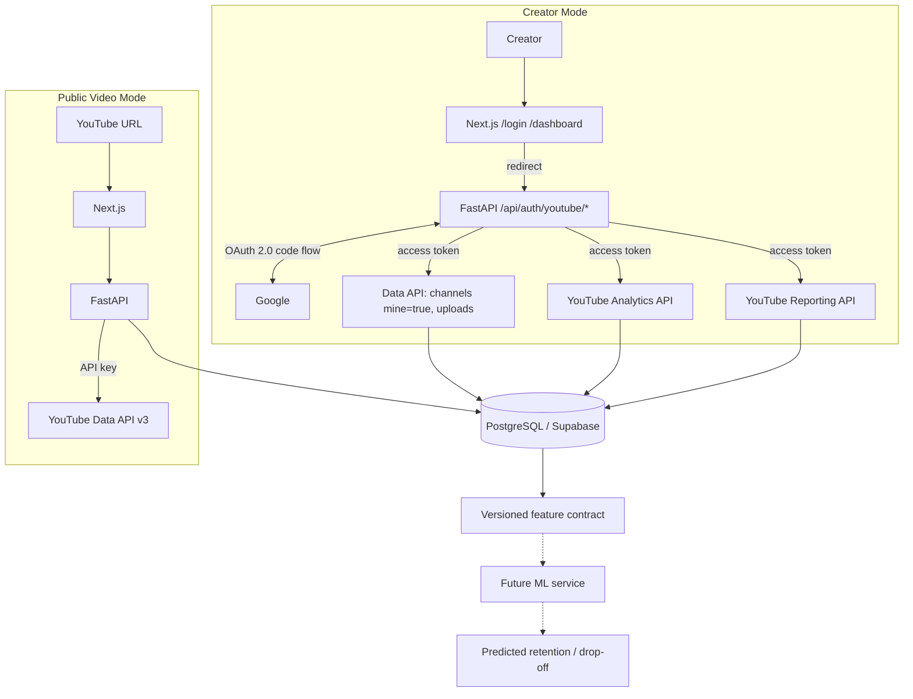

# RetainAI — Retention Predictor

**Find the drop-off before you publish.** A lightweight, retention-focused alternative to YouTube Studio:
paste any public video link, or connect your channel to see analytics and real audience-retention curves.

## 1. Current scope

| Mode | What works today |
| --- | --- |
| **Public Video Mode** (no login) | Paste a YouTube URL → video + channel metadata, public stats, category name, normalized report, DB cache, ML-ready feature payload |
| **Creator Mode** (Google OAuth) | Sign in with YouTube → channel identification, uploads sync (incl. private/unlisted), channel analytics, video table, per-video analytics, **audience retention curve** (`audienceWatchRatio`, `relativeRetentionPerformance`), observed drop-offs, traffic sources, geography, devices, Reporting API jobs, background sync |

**Not implemented (intentionally):** any machine learning — no Random Forest/XGBoost/SHAP, no predicted retention, no predicted drop-offs, no LLM/AI suggestions. The UI shows placeholders ("Your ML model will appear here") and **no fake numbers**. See [docs/ml-integration.md](docs/ml-integration.md).

## 2. Architecture



Which API does what:

| Application feature | API |
| --- | --- |
| Public video metadata | YouTube Data API v3 (API key) |
| Authenticated user's channel | YouTube Data API v3 + OAuth |
| Uploaded videos | YouTube Data API v3 + OAuth |
| Channel overview metrics | YouTube Analytics API |
| Video performance metrics | YouTube Analytics API |
| Audience retention | YouTube Analytics API |
| Traffic sources / geography / devices | YouTube Analytics API |
| Bulk historical channel reports | YouTube Reporting API |
| Future ML input | Internal feature contract |

Layout:

```text
backend/    FastAPI (routes → services → repositories → models), tests
frontend/   Next.js 16 · TypeScript · Tailwind · TanStack Query · Recharts
future-ml/  contracts for the ML team (JSON Schemas)
docs/       ml-integration.md
```

Backend structure: `routes/` (thin) · `services/` (oauth, youtube data/analytics/reporting/sync, ml stub) · `repositories/` (DB access) · `schemas/` (Pydantic) · `models/` (SQLAlchemy) · `utils/`.

## 3. Tech stack

Next.js · TypeScript · Tailwind · TanStack Query · Recharts · FastAPI · Pydantic v2 · httpx · SQLAlchemy 2 (async) · PostgreSQL (Supabase) · `cryptography` (token encryption).

## 4. Environment variables

Copy `.env.example`. The **backend reads `backend/.env`**; the frontend reads `frontend/.env.local`.

| Variable | Where | Secret? | Purpose |
| --- | --- | --- | --- |
| `YOUTUBE_API_KEY` | backend | **yes** | Public Data API calls |
| `GOOGLE_CLIENT_ID` | backend | no (but keep server-side) | OAuth web client |
| `GOOGLE_CLIENT_SECRET` | backend | **yes** | OAuth code exchange / refresh |
| `GOOGLE_REDIRECT_URI` | backend | no | Must exactly match Google Cloud. Default `http://localhost:8000/api/auth/youtube/callback` |
| `DATABASE_URL` | backend | **yes** | Postgres connection string (`postgresql://…`). Empty/invalid → local SQLite fallback (dev only) |
| `FRONTEND_URL` | backend | no | CORS origin + post-login redirect. Default `http://localhost:3000` |
| `BACKEND_URL` | backend | no | Informational |
| `SESSION_SECRET` | backend | **yes** | Encrypts stored OAuth tokens (Fernet key derived from it). Changing it logs everyone out |
| `NEXT_PUBLIC_API_BASE_URL` | **frontend** | no | Backend URL. The **only** variable exposed to the browser |

Never use `NEXT_PUBLIC_` for any secret. Optional tuning: `CACHE_TTL_HOURS` (public analyses, 6), `ANALYTICS_CACHE_MINUTES` (60), `MAX_SYNC_VIDEOS` (1000), `SESSION_TTL_DAYS` (14).

## 5. Google Cloud setup

1. Select (or create) a Google Cloud project.
2. **Enable APIs** (APIs & Services → Library): *YouTube Data API v3*, *YouTube Analytics API*, *YouTube Reporting API*.
3. **API key** (public mode): Credentials → Create credentials → API key. Under *API restrictions*, allow **YouTube Data API v3** (an API restriction that omits it gives `API_KEY_SERVICE_BLOCKED`). Leave *Application restrictions* = None locally; for a deployed server use IP addresses.
4. **OAuth consent screen**: External, add scopes below, and while the app is in *Testing* add your Google account under **Test users**. (Testing mode refresh tokens expire after 7 days; publish the app for long-lived access. Sensitive scopes need Google verification before public launch.)
5. **OAuth client**: Credentials → Create credentials → OAuth client ID → **Web application**.
6. **Authorized redirect URI** (exact match, including scheme, host, port, path):
   * Local: `http://localhost:8000/api/auth/youtube/callback`
   * Production: `https://YOUR_BACKEND_DOMAIN/api/auth/youtube/callback` (set `GOOGLE_REDIRECT_URI` accordingly; nothing is hardcoded)
7. Put `GOOGLE_CLIENT_ID`, `GOOGLE_CLIENT_SECRET`, `YOUTUBE_API_KEY`, `DATABASE_URL`, `SESSION_SECRET` in `backend/.env`.
   Generate the secret: `python -c "import secrets;print(secrets.token_urlsafe(48))"`.
8. For Supabase use the **Session pooler** connection string (the direct host is IPv6-only). Tables are created automatically on startup.

## 6. OAuth scopes

Exactly two, both read-only:

| Scope | Why |
| --- | --- |
| `https://www.googleapis.com/auth/youtube.readonly` | `channels.list?mine=true`, uploads playlist, video metadata incl. private/unlisted |
| `https://www.googleapis.com/auth/yt-analytics.readonly` | YouTube Analytics + Reporting API reads |

Not requested: any write scope, `yt-analytics-monetary.readonly`, or Google profile/email scopes. Consequence: the app identifies a user by their **YouTube channel** (name/avatar from the channel; `email` is empty). The sign-in requires both permissions; if one is unticked at consent the login is rejected with a clear message.

## 7. Running locally

Backend:

```bash
cd backend
python -m venv .venv
# Windows:       .venv\Scripts\activate
# Linux/macOS:   source .venv/bin/activate
pip install -r requirements.txt
uvicorn app.main:app --reload --port 8000
```

Swagger UI: http://localhost:8000/docs

Frontend:

```bash
cd frontend
npm install
npm run dev        # http://localhost:3000
```

Tests (no real network; Google is mocked):

```bash
cd backend
pip install -r requirements-dev.txt
pytest
```

## 8. API reference

Errors are always `{"error": {"code": "...", "message": "..."}}` (no Google stack traces, no secrets).
Creator routes need the session cookie (`401 NOT_AUTHENTICATED` otherwise). Date params are `start_date` / `end_date` (`YYYY-MM-DD`, default last 28 days); `refresh=true` bypasses the cache.

### Public mode

| Method & route | Description |
| --- | --- |
| `GET /health` | `{"status":"ok","database":"postgres\|sqlite-fallback"}` |
| `GET /api/youtube/video/{video_id}` | Normalized public video (title, channel, duration, category name, stats, thumbnail) |
| `POST /api/analyze` `{"youtube_url"}` | Validate → fetch video+channel → cache in DB → report with `features`, `feature_readiness`, `ml_status`. `?refresh=true` skips the cache. Returns `cached` flag |
| `GET /api/analyses` · `GET /api/analyses/{id}` | Recent analyses · one stored report (`?include_raw=true`) |
| `GET /api/youtube/channel/{channel_id}` | Public channel (accepts `UC…` id or `@handle`) |
| `GET /api/youtube/channel/{channel_id}/videos?limit=&pageToken=` | Paginated recent uploads (`items`, `next_page_token`) |

### Auth

| Method & route | Description |
| --- | --- |
| `GET /api/auth/youtube/login` | 302 to Google (state in a short-lived HttpOnly cookie) |
| `GET /api/auth/youtube/callback` | Validates `state`, exchanges the code, identifies the channel, stores encrypted tokens, sets the session cookie, 302 to `/dashboard`. Failures 302 to `/login?error=<CODE>` |
| `GET /api/auth/me` | `{authenticated, user:{name,email,image}, channel:{id,title}}` — never tokens |
| `POST /api/auth/logout` | Deletes the server-side session (does **not** revoke the Google grant) |

### Creator channel & sync

| Method & route | Description |
| --- | --- |
| `GET /api/channel/me` | Stored channel (subscribers, views, video count, uploads playlist id, `last_synced_at`) |
| `GET /api/channel/me/videos?page&limit&search&sort` | Synced library from the DB (`sort`: newest, oldest, views, longest, shortest) |
| `POST /api/sync` | Starts a background sync → `{"sync_id","status":"started"}` (returns the running job if one exists) |
| `GET /api/sync/{sync_id}` | `{status: started\|running\|completed\|failed, step, stats, error_*}` |

### Analytics (YouTube Analytics API, cached 60 min in PostgreSQL)

| Route | Description |
| --- | --- |
| `GET /api/analytics/overview` | views, engaged views (when supported), watch time (min), avg view duration (s), avg view % (percent), likes, comments, shares, subs gained/lost, **net subs** (= gained − lost) |
| `GET /api/analytics/timeseries` | Per-day views, watch time, subs gained/lost/net |
| `GET /api/analytics/videos?page&limit&sort&search` | Library merged with **one batched** Analytics report (top 200 videos by views in range). `sort`: newest, oldest, views, highest_avp, lowest_avp, longest, shortest. Includes descriptive `insights` (avg/median view %, duration, views per video, videos analyzed) |
| `GET /api/analytics/video/{video_id}` | One video's metrics |
| `GET /api/analytics/video/{video_id}/retention` | `elapsedVideoTimeRatio` curve: raw `points[]` (`time_ratio`, `audience_watch_ratio`, `relative_retention_performance`, optional `started_watching`/`stopped_watching`) and `observed_drop_offs` (largest actual declines — not predictions). **One video per request** (an Analytics API requirement) and only requested when a video is selected |
| `GET /api/analytics/video/{video_id}/ml-features` | Versioned ML contract (see docs) |
| `GET /api/analytics/traffic-sources` · `/geography` · `/devices` | Breakdown rows (views, watch time, avg duration, avg view % where YouTube supports them); optional `video_id` |

### Reporting API

| Method & route | Description |
| --- | --- |
| `GET /api/reporting/report-types` | `reportTypes.list` |
| `GET /api/reporting/jobs` | Jobs stored for the user |
| `POST /api/reporting/jobs` `{"report_type"?}` | Idempotent job creation (default `channel_basic_a3`) |
| `GET /api/reporting/jobs/{id}` · `/jobs/{id}/reports` | `jobs.get` · `jobs.reports.list` (records generated reports; no downloads) |
| `POST /api/reporting/reports/{id}/process` | Downloads one report on demand, records row count/columns (contents aren't stored) |

### ML (not implemented)

| Route | Description |
| --- | --- |
| `POST /api/ml/predict` | Contract only → `501 ML_NOT_IMPLEMENTED` |

Common error codes: `INVALID_URL` 400 · `VIDEO_NOT_FOUND` 404 · `INVALID_DATE_RANGE` 400 · `NOT_AUTHENTICATED`/`REAUTH_REQUIRED`/`TOKEN_INVALID` 401 · `QUOTA_EXCEEDED`, `API_NOT_ENABLED`, `API_KEY_RESTRICTED`, `ANALYTICS_PERMISSION`, `REPORTING_PERMISSION` 403 · `NO_CHANNEL` 404 · `ANALYTICS_UNAVAILABLE` · `RATE_LIMITED` 429 · `UPSTREAM_ERROR` 502.

## 9. Analytics data model

* **Units** (as YouTube returns them): `watch_time_minutes`, `average_view_duration_seconds`, `average_view_percentage` is a **percent 0–100**. Missing values stay `null` ("—" in the UI); nothing is invented. Net subscribers = gained − lost.
* **Retention** uses `elapsedVideoTimeRatio` (0–1 of the video's length), so curves are normalized across durations. `audienceWatchRatio` is the share of the audience watching at that point (can exceed 100% with rewatches); `relativeRetentionPerformance` compares with videos of similar length (shown as `1.17×`, never a 0–100 score). Points are raw and unsmoothed.
* **Observed drop-offs** are the largest consecutive declines in `audienceWatchRatio`, labelled *observed*. Predicted data will be kept separate.
* **Caching:** `analytics_cache` stores each normalized report keyed by user + report type + video + date range (+ dimensions), with `fetched_at`; reads within `ANALYTICS_CACHE_MINUTES` skip Google. The UI/API `refresh=true` forces a fetch.
* **Tables:** `videos`, `channels`, `video_analysis`, `future_predictions` (public mode) · `users`, `oauth_accounts` (encrypted tokens), `sessions`, `youtube_channels`, `analytics_cache`, `sync_jobs`, `youtube_reporting_jobs`, `youtube_reports`. `videos` also holds `privacy_status` and `upload_position`.
* **Known limit:** the batched per-video report returns YouTube's top 200 videos by views in the selected range; videos with no views in range show "—".

## 10. Reporting API

The Reporting API is **not** an instant mirror of YouTube Studio. It generates bulk report files asynchronously (daily) for a *job* you create per report type. This app:

1. creates one `channel_basic_a3` job per user (idempotent: checks the DB, then YouTube, then creates),
2. lists generated reports on sync (`jobs.reports.list`) and records them in `youtube_reports`,
3. downloads a report only when you call `/process`.

New jobs usually take a day or two to produce the first report. The dashboard never waits on it; it uses the Analytics API for immediate data. Division of labour: **Analytics API** = interactive queries · **Reporting API** = bulk historical ingestion · **Data API** = channel/video metadata.

## 11. Security

* Tokens: access/refresh tokens are **encrypted at rest** (Fernet, key derived from `SESSION_SECRET`), never sent to the browser, never logged (HTTP client logging is silenced because request URLs can contain keys).
* Sessions: server-side; the browser holds only an opaque random id in an **HttpOnly, SameSite=Lax** cookie (`Secure` automatically when `FRONTEND_URL` is https). No `localStorage`/`sessionStorage`.
* OAuth `state` is random per login, stored in an HttpOnly cookie and checked with a constant-time comparison.
* API keys and the client secret live only in `backend/.env` (gitignored, with credentials/token/report files). Only `NEXT_PUBLIC_API_BASE_URL` reaches the browser.
* Automatic token refresh happens server-side; if the refresh token is revoked/expired the user is asked to sign in again (`REAUTH_REQUIRED`).
* **Local-dev caveat:** frontend (`:3000`) and backend (`:8000`) are same-site on `localhost`, so cookies work. In production put both on the same registrable domain, or the SameSite=Lax session cookie won't be sent on cross-site fetches.

## 12. ML integration

See **[docs/ml-integration.md](docs/ml-integration.md)** — feature schema, prediction schema, endpoint contract and the exact plug-in point (`backend/app/services/ml_service.py`).
References (not copied into this repo): [avalanchesiqi/youtube-engagement](https://github.com/avalanchesiqi/youtube-engagement) · [Mukeshthenraj/Video-engagement-prediction](https://github.com/Mukeshthenraj/Video-engagement-prediction) (Random Forest, XGBoost, GridSearchCV, ROC-AUC, candidate features such as `title_word_count`, `document_entropy`, `freshness`, `easiness`, `fraction_stopword_presence`, `speaker_speed`, `silent_period_rate`).

## 13. Roadmap

1. ✅ Public YouTube Data API ingestion
2. ✅ Creator OAuth + Analytics + Reporting foundation + dashboard (this phase)
3. Transcript/audio/visual feature extraction
4. Random Forest / XGBoost baseline
5. Retention curve prediction
6. Risk segment detection
7. LLM-based reasoning
8. Actionable edit suggestions
9. Predicted vs actual retention validation (ground truth: creator retention curves)
